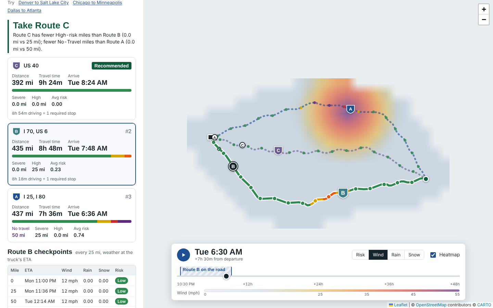

# Truck Route Safety

A React + Django web app that helps a truck driver pick the safest route between two places. It weighs
forecast weather at the time the truck will actually be at each point, the load weight, and travel time.



**Live app:** https://truck-route-safety.onrender.com · **Walkthrough:** _add your Loom link here_

## What it does

1. The driver enters an origin, a destination, a departure time, a load weight and a checkpoint spacing (10, 25 or 50 mi).
2. The backend asks OSRM for up to three distinct routes.
3. Each route gets a checkpoint every 10, 25 or 50 miles. A checkpoint's ETA comes from truck-adjusted driving time, plus required driver rest stops if that option is on.
4. One batched Open-Meteo request fetches the hourly forecast for every checkpoint. Each checkpoint reads the forecast **at its own ETA**, not at departure time.
5. Each checkpoint is classified with the risk table and load rules. Its risk applies to the miles around it.
6. Routes are ranked: fewest Severe miles, then fewest High miles, then lowest average risk, then shortest time. The top route is recommended, with a one-line reason.
7. The map shows all three routes. The selected route is colored by risk, with checkpoints, ETAs, rest stops and a summary label for each route.
8. A second request builds a weather heatmap over the trip corridor for the next 48 hours. A slider scrubs through it while a truck marker moves along every route.

## Risk logic

All the rules live in [`backend/routeplanner/domain/risk.py`](backend/routeplanner/domain/risk.py) and are covered by unit tests.

| Condition | Low | Moderate | High | Severe | No Travel |
|---|---|---|---|---|---|
| Wind (mph) | < 25 | 25 – 34 | 35 – 44 | 45 – 54 | ≥ 55 |
| Rain (in/hr) | < 0.10 | 0.10 – 0.25 | 0.25 – 0.50 | 0.50 – 1.00 | > 1.00 |
| Snow (in/hr) | < 0.5 | 0.5 – 1.0 | 1.0 – 2.0 | 2.0 – 3.0 | > 3.0 |

- **Band edges:** each band includes its lower bound (25 mph is Moderate). Where the brief writes `>`, the edge value stays in the band below: 1.00 in/hr of rain is Severe and 1.01 is No Travel.
- **Overall level** is the worst of wind, rain and snow.
- **Load rules can only raise the level, never lower it:**
  - ≥ 55 mph: No Travel for any load.
  - 45–54 mph and more than 30,000 lb: No Travel.
  - 35–44 mph and more than 40,000 lb: Severe.
- Every checkpoint also returns its **drivers**, for example "Wind 40 mph with 45,000 lb load", so the UI can explain itself.

### From checkpoints to route miles

Each checkpoint stands for the stretch of road closer to it than to any other checkpoint. That stretch runs halfway to each neighbouring checkpoint. With 25-mile spacing a mid-route checkpoint covers 25 miles, and a route's miles across all risk levels add up exactly to its length. This is a neutral reading of the samples. The alternative, giving each gap the worse of its two ends, would double-count every hazard.

### Recommendation

Routes are compared on these criteria in order. The first criterion that differs decides
([`scoring.py`](backend/routeplanner/domain/scoring.py)):

0. **Fewest No-Travel miles.** I added this as an explicit first step so a No-Travel stretch always counts as worse than Severe.
1. Fewest Severe miles.
2. Fewest High miles.
3. Lowest average risk, weighted by distance (Low = 0 through No Travel = 4).
4. Shortest door-to-door travel time.

Differences under 0.1 mi, 0.01 average risk or 1 minute count as ties, so rounding noise doesn't decide the outcome. The explanation names the deciding criterion for each comparison. If every route crosses No-Travel conditions, a warning suggests delaying, and the forecast slider shows when conditions clear.

## Weather sampling details

Open-Meteo reports values differently by type, so the app samples them differently ([`weather.py`](backend/routeplanner/services/weather.py)):

- **Wind** (sustained 10 m wind, in mph) is an instantaneous value. It is interpolated linearly between the two surrounding hours. Gusts are shown in tooltips, and `WIND_METRIC=gust` switches classification to gusts if you prefer the stricter reading.
- **Rain** (`rain` + `showers`) and **snowfall** are totals over the preceding hour, which makes them a rate in in/hr. The app uses the hour bucket that contains the ETA.
- Units are requested in mph and inches. The response's units are still checked and converted, so a metric response can't silently break the thresholds.
- Points within about 1 km share a forecast, and locations are batched 50 per request in parallel. Responses are cached for 15 minutes.
- **Backup source.** Open-Meteo's free tier has a daily cap per IP address, and free cloud hosts share IPs between many apps. If Open-Meteo refuses, errors or times out, the app switches to MET Norway's free Locationforecast API ([`met_norway.py`](backend/routeplanner/services/met_norway.py)). After a rate-limit error it skips Open-Meteo for an hour. MET Norway reports total precipitation only, so it is split into rain or snow using the forecast's symbol code ("snow", "sleet"), or the temperature when there is none. Snow depth uses 1 mm of water = 0.7 cm of snow.

## ETA model

- **Truck speed:** OSRM's car timing is used, but no step is driven faster than 65 mph (`TRUCK_MAX_SPEED_MPH`).
- **Hours of service** (on by default, can be switched off): a 30-minute break after 8 hours of driving, and 10 hours off after 11 hours of driving. Checkpoint ETAs include these stops. The stops are drawn on the map and shown on the slider's trip window. See [`hos.py`](backend/routeplanner/domain/hos.py).

## Route alternatives

OSRM's public server often returns fewer than three alternatives on long trips. When that happens, the backend routes through via points pushed sideways from the fastest route. It keeps a candidate only if it is at most 1.8 times slower and shares no more than 80% of its length with a route already kept. If three distinct routes still can't be found, the app shows the ones it has and says so.

## Map, heatmap and performance

- **Leaflet with the canvas renderer.** Hundreds of checkpoint markers draw on a single canvas. The route layers are memoised, so moving the slider never re-renders them.
- **Heatmap.** The backend builds a grid along the corridor: every cell within 40 miles of any route, capped at 350 forecast points. The grid is evenly spaced in Web-Mercator y, so it lines up with the map. The browser paints one pixel per cell into a tiny `<canvas>` and Leaflet stretches it over the map; bilinear scaling makes it smooth.
- **Smooth scrubbing.** All 49 hourly frames are pre-rendered as RGBA buffers. The slider moves in 15-minute steps, and in-between frames are cross-faded with a `putImageData` call of a few KB, so scrubbing and the play button stay at 60 fps.
- **Layers:** risk for this load, or raw wind, rain or snow. Color stops sit on the risk-table thresholds.
- **Truck markers.** The backend sends a clock time for every path vertex, with rest stops encoded as two identical points. The browser places each truck with a binary search and interpolation. The shaded band on the slider marks the selected route's trip window.
- **Routes come back first.** The plan request returns routes quickly, and the heatmap loads after it in the background.

## Project layout

```
backend/
  config/                  Django settings, URLs, WSGI
  routeplanner/
    domain/                pure logic, no I/O: risk.py, scoring.py, geo.py, hos.py
    services/              external APIs + orchestration: routing, weather (+ MET Norway backup), geocoding, planner, heatmap
    validation.py          request parsing
    views.py               JSON endpoints
    tests/                 62 unit and API tests (network is mocked)
frontend/src/
  App.tsx                  state and data flow
  components/              form, route cards, checkpoint table, timeline
  components/map/          TripMap, RouteLayers, HeatmapOverlay
  lib/                     formatting, risk colors, heatmap rendering, truck position
```

## API

| Method | Path | Body or query | Returns |
|---|---|---|---|
| GET | `/api/health` | none | `{status: "ok"}` |
| GET | `/api/geocode?q=denver` | `q`, at least 3 characters | `{results: [{label, lat, lng}]}` |
| POST | `/api/plan` | `{origin, destination, departure, load_lb, interval_mi, hos}` | routes, checkpoints, stats, recommendation |
| POST | `/api/heatmap` | `{paths, departure, load_lb}` | corridor grid and 49 hourly layers |

`origin` and `destination` can be `{label, lat, lng}` or free text, which is geocoded. `departure` is ISO 8601 with a time-zone offset, within the next 7 days.

Error responses: `400` returns per-field messages, `422` means no drivable route, and `502` means an upstream API failed.

## Run locally

Requirements: Python 3.11+ and Node 20+.

```bash
# API
cd backend
python -m venv .venv && source .venv/bin/activate
pip install -r requirements.txt
python manage.py runserver            # http://127.0.0.1:8000

# Web app (second terminal)
cd frontend
npm install
npm run dev                           # http://localhost:5173 (proxies /api to :8000)
```

Tests:

```bash
cd backend && python manage.py test routeplanner
cd frontend && npm run build          # type-check and production build
```

No API keys are needed. OSRM, Open-Meteo, Photon and the Esri light-grey base map are all free.

## Deploy (Render, one service)

1. Push this repository to GitHub.
2. In Render, choose **New > Blueprint** and select the repository. `render.yaml` builds the `Dockerfile`, which compiles the React app and serves it from Django with gunicorn and WhiteNoise.
3. Open the URL Render gives you. The health check is at `/api/health`.

Any Docker host works the same way: `docker build -t trs . && docker run -p 8000:8000 trs`.

### Settings (environment variables)

| Variable | Default | Purpose |
|---|---|---|
| `OSRM_BASE_URL` | `https://router.project-osrm.org` | Point at your own OSRM for production volume |
| `TRUCK_MAX_SPEED_MPH` | `65` | Truck speed cap |
| `WIND_METRIC` | `sustained` | Set to `gust` to classify by gusts |
| `HEATMAP_MAX_CELLS` / `HEATMAP_CORRIDOR_MI` | `350` / `40` | Heatmap resolution and width |
| `DJANGO_SECRET_KEY`, `DJANGO_DEBUG`, `DJANGO_ALLOWED_HOSTS` | | Standard Django settings |

## Known limitations

- The public OSRM server uses a car profile and is rate-limited. It has no truck restrictions such as low bridges or hazmat rules. A self-hosted OSRM with a truck profile, or a truck-aware commercial router, plugs in through `OSRM_BASE_URL` or `services/routing.py`.
- Forecasts are only as good as the model. Open-Meteo blends national models at 1–11 km resolution.
- The hours-of-service model is simplified: no 14-hour window and no weekly limits.
- The in-process cache is per worker. Redis would be the next step for multiple instances.
